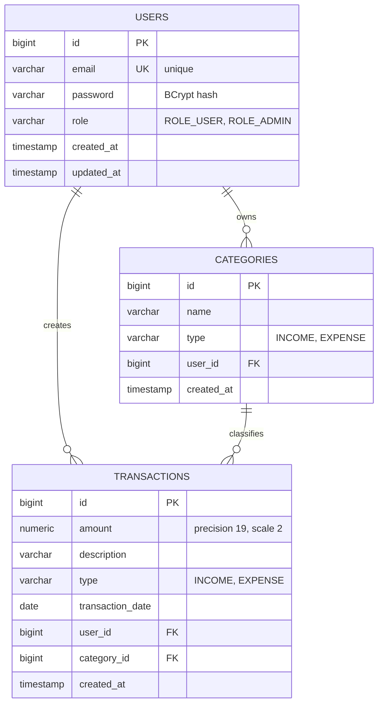

# 💰 Personal Finance REST API

[](https://www.oracle.com/java/)
[](https://spring.io/projects/spring-boot)
[](https://spring.io/projects/spring-security)
[](https://www.postgresql.org/)
[](https://www.docker.com/)
[](https://swagger.io/)
[](https://opensource.org/licenses/MIT)

> **Languages:** 🇬🇧 **English** | [🇹🇷 Türkçe](README.tr.md)

A production-grade, highly secure, and multi-tenant **Personal Finance Management RESTful API** built with modern **Java 21** and **Spring Boot**. 

The system enables users to track personal revenues and expenditures, organize categories, monitor financial health via aggregated real-time dashboard analytics, and guarantees strict **data isolation** and **role-based access control (RBAC)** powered by stateless **JWT (JSON Web Tokens)**.

---

## 📑 Table of Contents
- [Key Features](#-key-features)
- [Architecture & Design Principles](#-architecture--design-principles)
- [Tech Stack](#-tech-stack)
- [Database Schema & Data Isolation](#-database-schema--data-isolation)
- [API Endpoints](#-api-endpoints)
- [Pre-configured Test Accounts](#-pre-configured-test-accounts)
- [Getting Started](#-getting-started)
  - [Prerequisites](#prerequisites)
  - [Environment Configuration](#environment-configuration)
  - [Running with Docker & Maven](#running-with-docker--maven)
- [Testing](#-testing)
- [Interactive API Documentation (Swagger)](#-interactive-api-documentation-swagger)
- [License](#-license)

---

## 🚀 Key Features

- **🔐 Stateless JWT Authentication:**
  - Secure user registration and login (`BCrypt` password hashing).
  - URL-safe Base64 256-bit signed HMAC-SHA JWT generation and validation via `io.jsonwebtoken` (JJWT 0.13.x).
  - Custom `JwtAuthenticationFilter` (`OncePerRequestFilter`) integrated seamlessly into the Spring Security filter chain.
- **🛡️ Role-Based Access Control (RBAC):**
  - Granular method security enabled with `@EnableMethodSecurity` and `@PreAuthorize("hasRole('ADMIN')")`.
  - Distinguishes standard users (`ROLE_USER`) from system administrators (`ROLE_ADMIN`). Standard users receive `403 Forbidden` on admin-level endpoints.
- **🔒 Strict Data Ownership & Isolation:**
  - Users can **only** view, edit, or delete their own financial records. Derived JPA queries enforce multi-tenancy (`findByIdAndUserId`).
- **📊 Real-time Financial Dashboard & Aggregations:**
  - Optimized database-level aggregation via JPQL (`SUM`, `COALESCE`, `GROUP BY`, `ORDER BY`).
  - Single endpoint calculation for:
    - Total Income
    - Total Expenses
    - Net Savings Balance (`Income - Expense`)
    - Categorical expenditure breakdown sorted by top spendings.
- **💳 Transaction Management:**
  - Full CRUD operations supporting both `INCOME` and `EXPENSE`.
  - Built-in pagination (`Pageable`), sorting (`Sort`), and multi-criteria filtering by transaction type and date range (`startDate`, `endDate`).
- **🏷️ Category Management:**
  - User-specific custom categories with duplicate protection.
- **📖 OpenAPI 3 / Swagger UI:**
  - Fully interactive API documentation with integrated **JWT Bearer Authorization** modal for in-browser testing.
- **🧪 Comprehensive Unit Testing:**
  - 16 isolated unit tests built with **JUnit 5** and **Mockito**, covering happy paths and edge cases.

---

## 🏛️ Architecture & Design Principles

The application follows clean, industry-standard **Layered Architecture**:

```
Client (Postman / Web / Mobile)
               │
               ▼
   [ JwtAuthenticationFilter ]  ◄── (Extracts Bearer Token & Validates Claims)
               │
               ▼
         [ Controller ]         ◄── (HTTP, @Valid Bean Validation, Swagger Annotations)
               │
               ▼
          [ Service ]          ◄── (Business Logic, DTO Mapping, Security Assertions)
               │
               ▼
         [ Repository ]         ◄── (Spring Data JPA, JPQL Aggregations)
               │
               ▼
     [ PostgreSQL Database ]    ◄── (Docker Container, Port 5433)
```

- **DTO Pattern:** Entities are strictly isolated from the presentation layer. Request/Response DTOs enforce encapsulation and prevent mass-assignment vulnerabilities.
- **Bean Validation:** Inputs are strictly validated via Jakarta Validation (`@NotBlank`, `@Email`, `@Positive`, `@PastOrPresent`, `@Size`).
- **Global Exception Handling:** Centralized `@RestControllerAdvice` converts exceptions (`ResourceNotFoundException`, `DuplicateResourceException`, `BadCredentialsException`) into structured, predictable JSON error payloads.
- **Fail-Fast Configuration:** Security keys and environment configurations are decoupled into `.env` to prevent credential leakage.

---

## 🛠️ Tech Stack

| Layer / Component | Technology | Version |
| :--- | :--- | :--- |
| **Language** | Java (JDK) | 21 (LTS) |
| **Framework** | Spring Boot | 4.1.2 |
| **Security** | Spring Security & JJWT | 6.x / 0.13.0 |
| **Database** | PostgreSQL | 16 (Alpine) |
| **ORM / Data Access** | Spring Data JPA / Hibernate | 7.x |
| **Containerization**| Docker & Docker Compose | Latest |
| **API Docs** | SpringDoc OpenAPI (Swagger UI) | 3.2.0 |
| **Testing** | JUnit 5, Mockito, AssertJ | Latest |
| **Build Tool** | Apache Maven | Wrapper (mvnw) |
| **Productivity** | Project Lombok | Latest |

---

## 🗄️ Database Schema & Data Isolation



---

## 📡 API Endpoints

### 1. Authentication (`/api/v1/auth`)
| Method | Endpoint | Access | Description |
| :--- | :--- | :--- | :--- |
| `POST` | `/api/v1/auth/register` | Public | Register a new user account |
| `POST` | `/api/v1/auth/login` | Public | Authenticate user & receive JWT Bearer Token |

### 2. Financial Dashboard (`/api/v1/dashboard`)
| Method | Endpoint | Access | Description |
| :--- | :--- | :--- | :--- |
| `GET` | `/api/v1/dashboard/summary` | User | Get total income, expenses, balance & category spendings |

### 3. Categories (`/api/v1/categories`)
| Method | Endpoint | Access | Description |
| :--- | :--- | :--- | :--- |
| `GET` | `/api/v1/categories` | User | List all categories owned by logged-in user |
| `POST` | `/api/v1/categories` | User | Create a new custom category |
| `GET` | `/api/v1/categories/{id}` | User | Get specific category details |
| `DELETE` | `/api/v1/categories/{id}` | User | Delete category by ID |

### 4. Transactions (`/api/v1/transaction`)
| Method | Endpoint | Access | Description |
| :--- | :--- | :--- | :--- |
| `GET` | `/api/v1/transaction` | User | List paginated & filtered transactions (`type`, `startDate`, `endDate`) |
| `POST` | `/api/v1/transaction` | User | Record a new transaction (Income/Expense) |
| `PUT` | `/api/v1/transaction/{id}` | User | Update an existing transaction |
| `DELETE` | `/api/v1/transaction/{id}` | User | Delete a transaction |

### 5. Administration (`/api/v1/admin`)
| Method | Endpoint | Access | Description |
| :--- | :--- | :--- | :--- |
| `GET` | `/api/v1/admin/users` | **ADMIN only** | List all registered users across system |
| `GET` | `/api/v1/admin/stats` | **ADMIN only** | System overview (total users, categories, transactions) |

---

## 👥 Pre-configured Test Accounts

When the application boots, `DataInitializer` seeds test accounts with BCrypt-hashed credentials:

| Role | Email | Password | Allowed Scopes |
| :--- | :--- | :--- | :--- |
| **ROLE_USER** | `ahmet@example.com` | `123456` | Personal Categories, Transactions, Dashboard |
| **ROLE_USER** | `mehmet@example.com`| `pass123` | Personal Categories, Transactions, Dashboard |
| **ROLE_ADMIN**| `admin@example.com` | `admin123`| All User endpoints + `/api/v1/admin/**` |

---

## 🏁 Getting Started

### Prerequisites
- **Java 21** or later
- **Docker Desktop** (for PostgreSQL)
- **Git**

### Environment Configuration
1. Clone the repository:
   ```bash
   git clone https://github.com/your-username/PersonalFinanceAPI.git
   cd PersonalFinanceAPI
   ```

2. Create a `.env` file in the project root directory:
   ```properties
   POSTGRES_DB=personal_finance_db
   POSTGRES_USER=postgres
   POSTGRES_PASSWORD=your_secure_password
   JWT_SECRET=your_base64_url_safe_256bit_secret_key_here
   ```

### Running with Docker & Maven
1. **Start the PostgreSQL Container:**
   ```bash
   docker compose up -d
   ```
   *(Note: The database is published on port `5433` to prevent conflicts with local PostgreSQL instances).*

2. **Run the Spring Boot Application:**
   ```bash
   # Windows PowerShell / CMD
   .\mvnw.cmd spring-boot:run

   # Linux / macOS
   ./mvnw spring-boot:run
   ```

Application will start on port `8080`.

---

## 🧪 Testing

The test suite contains **16 unit tests** verifying service logic, security checks, and database aggregation mapping:

```bash
# Execute all unit tests
.\mvnw.cmd test
```

Test Results Breakdown:
- `PersonalFinanceApplicationTests`: Spring ApplicationContext sanity test.
- `AuthServiceImplTest`: Registration, duplicate checks, login, and bad credentials validation.
- `CategoryServiceImplTest`: Category CRUD & ownership isolation tests.
- `TransactionServiceImplTest`: Transaction creation, updates, and user-scoped retrieval tests.
- `DashboardServiceImplTest`: Financial summary calculation & zero-activity corner cases.

---

## 📖 Interactive API Documentation (Swagger)

The API is fully documented via OpenAPI 3. Access Swagger UI in your browser:
👉 **[http://localhost:8080/swagger-ui/index.html](http://localhost:8080/swagger-ui/index.html)**

### Authenticating in Swagger:
1. Call `POST /api/v1/auth/login` with your credentials.
2. Copy the `accessToken` from the response body.
3. Click the green **Authorize 🔒** button at the top right of the Swagger UI.
4. Paste the token into the field (no need to prefix with `Bearer`) and click **Authorize**.
5. All protected endpoints can now be executed directly in your browser!

---

## 📄 License
This project is open-source and available under the [MIT License](LICENSE).
