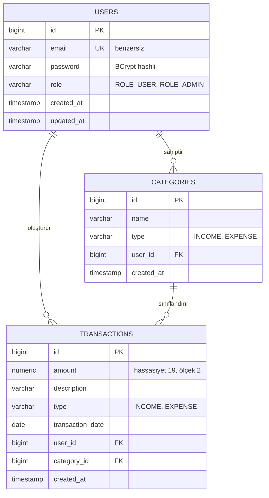

# 💰 Kişisel Finans Yönetimi REST API

[](https://www.oracle.com/java/)
[](https://spring.io/projects/spring-boot)
[](https://spring.io/projects/spring-security)
[](https://www.postgresql.org/)
[](https://www.docker.com/)
[](https://swagger.io/)
[](https://opensource.org/licenses/MIT)

> **Diller:** [🇬🇧 English](README.md) | 🇹🇷 **Türkçe**

Modern **Java 21** ve **Spring Boot** kullanılarak geliştirilmiş, kurumsal standartlarda, yüksek güvenlikli ve çok kullanıcılı (multi-tenant) bir **Kişisel Finans Yönetimi RESTful API** projesidir.

Sistem; kullanıcıların gelir ve giderlerini kaydetmelerini, kategorilerini yönetmelerini, gerçek zamanlı finansal özet ve analiz panelleriyle durumlarını izlemelerini sağlar. Durumsuz (stateless) **JWT (JSON Web Token)** mimarisi ve **Rol Tabanlı Yetkilendirme (RBAC)** ile katı bir **veri izolasyonu** ve güvenlik sunar.

---

## 📑 İçindekiler
- [Öne Çıkan Özellikler](#-öne-çıkan-özellikler)
- [Mimari ve Tasarım Prensipleri](#-mimari-ve-tasarım-prensipleri)
- [Teknoloji Yığını](#-teknoloji-yığını)
- [Veritabanı Şeması ve Veri İzolasyonu](#-veritabanı-şeması-ve-veri-izolasyonu)
- [API Uç Noktaları (Endpoints)](#-api-uç-noktaları-endpoints)
- [Önceden Tanımlı Test Kullanıcıları](#-önceden-tanımlı-test-kullanıcıları)
- [Kurulum ve Başlangıç](#-kurulum-ve-başlangıç)
  - [Gereksinimler](#gereksinimler)
  - [Ortam Değişkenleri (.env)](#ortam-değişkenleri-env)
  - [Docker ve Projeyi Çalıştırma](#docker-ve-projeyi-çalıştırma)
- [Birim Testleri (Unit Tests)](#-birim-testleri-unit-tests)
- [İnteraktif API Dokümantasyonu (Swagger)](#-interaktif-api-dokümantasyonu-swagger)
- [Lisans](#-lisans)

---

## 🚀 Öne Çıkan Özellikler

- **🔐 Durumsuz (Stateless) JWT Kimlik Doğrulama:**
  - Güvenli kullanıcı kaydı (register) ve girişi (login) — şifreler `BCrypt` ile hashlenir.
  - URL-safe Base64 256-bit HMAC-SHA algoritması ile imzalanan JWT üretimi ve doğrulaması (`io.jsonwebtoken` JJWT 0.13.x).
  - Spring Security filtre zincirine entegre edilmiş özel `JwtAuthenticationFilter` (`OncePerRequestFilter`).
- **🛡️ Rol Tabanlı Yetkilendirme (RBAC):**
  - `@EnableMethodSecurity` ve `@PreAuthorize("hasRole('ADMIN')")` ile metot seviyesinde güvenlik.
  - Standart kullanıcılar (`ROLE_USER`) ile sistem yöneticileri (`ROLE_ADMIN`) ayrılmıştır. Yetkisiz isteklerde anında `403 Forbidden` döner.
- **🔒 Katı Veri Sahipliği ve İzolasyonu:**
  - Her kullanıcı **yalnızca kendisine ait** kategori ve işlemleri görüntüleyebilir, güncelleyebilir veya silebilir (`findByIdAndUserId`).
- **📊 Gerçek Zamanlı Finansal Dashboard ve Toplamlar:**
  - Tüm harcamaları belleğe çekmek yerine doğrudan PostgreSQL motoru üzerinde çalışan optimize JPQL sorguları (`SUM`, `COALESCE`, `GROUP BY`, `ORDER BY`).
  - Tek bir istekte:
    - Toplam Gelir
    - Toplam Gider
    - Net Kalan Bakiye (`Gelir - Gider`)
    - En çok harcanan kategoriden aza doğru harcama dağılımı.
- **💳 İşlem (Gelir/Gider) Yönetimi:**
  - `INCOME` (Gelir) ve `EXPENSE` (Gider) türlerinde tam CRUD desteği.
  - Sayfalama (`Pageable`), sıralama (`Sort`) ve tarih/tür bazlı filtreleme parametreleri.
- **🏷️ Kategori Yönetimi:**
  - Kullanıcıya özel dinamik kategori oluşturma ve mükerrer kayıt kontrolü.
- **📖 OpenAPI 3 / Swagger UI:**
  - Tarayıcı üzerinden test için yeşil **Authorize** kilit butonu entegreli Swagger arayüzü.
- **🧪 Kapsamlı Birim Testleri:**
  - **JUnit 5** ve **Mockito** kullanılarak yazılmış, tüm servis ve yetkilendirme akışlarını doğrulayan 16 birim testi.

---

## 🏛️ Mimari ve Tasarım Prensipleri

Proje, katmanlı kurumsal mimari (**Layered Architecture**) standartlarına göre inşa edilmiştir:

```
İstemci (Postman / Web / Mobil)
               │
               ▼
   [ JwtAuthenticationFilter ]  ◄── (Bearer Token'ı ayıklar, imzayı ve süreyi doğrular)
               │
               ▼
         [ Controller ]         ◄── (HTTP istekleri, @Valid doğrulama, Swagger etiketleri)
               │
               ▼
          [ Service ]          ◄── (İş mantığı, DTO dönüşümleri, Güvenlik kontrolleri)
               │
               ▼
         [ Repository ]         ◄── (Spring Data JPA, JPQL hesaplama sorguları)
               │
               ▼
     [ PostgreSQL Database ]    ◄── (Docker Konteyneri, Port: 5433)
```

- **DTO Deseni:** Veritabanı Entity sınıfları dış dünyaya açılmaz; Request/Response DTO nesneleri ile veri transferi ve validasyon (`@Valid`) sağlanır.
- **Merkezi Hata Yönetimi:** `@RestControllerAdvice` ile yönetilen `GlobalExceptionHandler`, tüm hataları (`ResourceNotFoundException`, `DuplicateResourceException`, `BadCredentialsException`) standart JSON formatına dönüştürür.
- **Fail-Fast Prensibi:** Gizli anahtarlar kod içine gömülmez; `.env` dosyasından okunur ve eksik olduğunda uygulama güvenli bir şekilde ayağa kalkmayı reddeder.

---

## 🛠️ Teknoloji Yığını

| Katman / Bileşen | Teknoloji | Versiyon |
| :--- | :--- | :--- |
| **Programlama Dili** | Java (JDK) | 21 (LTS) |
| **Framework** | Spring Boot | 4.1.2 |
| **Güvenlik** | Spring Security & JJWT | 6.x / 0.13.0 |
| **Veritabanı** | PostgreSQL | 16 (Alpine) |
| **ORM / Veri Erişimi**| Spring Data JPA / Hibernate | 7.x |
| **Konteynerleştirme**| Docker & Docker Compose | Son Sürüm |
| **API Dokümantasyonu**| SpringDoc OpenAPI (Swagger UI) | 3.2.0 |
| **Test Kütüphaneleri**| JUnit 5, Mockito, AssertJ | Son Sürüm |
| **Derleme Aracı** | Apache Maven | Maven Wrapper (mvnw) |
| **Verimlilik** | Project Lombok | Son Sürüm |

---

## 🗄️ Veritabanı Şeması ve Veri İzolasyonu



---

## 📡 API Uç Noktaları (Endpoints)

### 1. Kimlik Doğrulama (`/api/v1/auth`)
| Metot | Endpoint | Erişim | Açıklama |
| :--- | :--- | :--- | :--- |
| `POST` | `/api/v1/auth/register` | Herkese Açık | Yeni kullanıcı hesabı kaydı |
| `POST` | `/api/v1/auth/login` | Herkese Açık | Giriş yapıp JWT Bearer Token alma |

### 2. Finansal Dashboard (`/api/v1/dashboard`)
| Metot | Endpoint | Erişim | Açıklama |
| :--- | :--- | :--- | :--- |
| `GET` | `/api/v1/dashboard/summary` | Kullanıcı | Toplam gelir, gider, net bakiye ve kategori dağılımı |

### 3. Kategoriler (`/api/v1/categories`)
| Metot | Endpoint | Erişim | Açıklama |
| :--- | :--- | :--- | :--- |
| `GET` | `/api/v1/categories` | Kullanıcı | Giriş yapan kullanıcının tüm kategorilerini listele |
| `POST` | `/api/v1/categories` | Kullanıcı | Yeni özel kategori ekle |
| `GET` | `/api/v1/categories/{id}` | Kullanıcı | Belirli bir kategoriyi getir |
| `DELETE` | `/api/v1/categories/{id}` | Kullanıcı | Kategoriyi sil |

### 4. Gelir / Gider İşlemleri (`/api/v1/transaction`)
| Metot | Endpoint | Erişim | Açıklama |
| :--- | :--- | :--- | :--- |
| `GET` | `/api/v1/transaction` | Kullanıcı | Sayfalı ve filtreli işlemleri listele (`type`, `startDate`, `endDate`) |
| `POST` | `/api/v1/transaction` | Kullanıcı | Yeni işlem kaydet (Gelir veya Gider) |
| `PUT` | `/api/v1/transaction/{id}` | Kullanıcı | Mevcut işlemi güncelle |
| `DELETE` | `/api/v1/transaction/{id}` | Kullanıcı | İşlemi sil |

### 5. Yönetici Paneli (`/api/v1/admin`)
| Metot | Endpoint | Erişim | Açıklama |
| :--- | :--- | :--- | :--- |
| `GET` | `/api/v1/admin/users` | **Yalnızca ADMIN** | Sistemdeki tüm kayıtlı kullanıcıları listele |
| `GET` | `/api/v1/admin/stats` | **Yalnızca ADMIN** | Sistem genel istatistikleri (kullanıcı, kategori, işlem sayısı) |

---

## 👥 Önceden Tanımlı Test Kullanıcıları

Uygulama ilk kez ayağa kalktığında `DataInitializer` tarafından oluşturulan hazır hesaplar:

| Rol | E-posta | Şifre | Yetki Alanı |
| :--- | :--- | :--- | :--- |
| **ROLE_USER** | `ahmet@example.com` | `123456` | Kendi kategorileri, işlemleri ve dashboard'u |
| **ROLE_USER** | `mehmet@example.com`| `pass123` | Kendi kategorileri, işlemleri ve dashboard'u |
| **ROLE_ADMIN**| `admin@example.com` | `admin123`| Tüm kullanıcı endpoint'leri + `/api/v1/admin/**` |

---

## 🏁 Kurulum ve Başlangıç

### Gereksinimler
- **Java 21** veya üzeri
- **Docker Desktop** (PostgreSQL için)
- **Git**

### Ortam Değişkenleri (.env)
1. Projeyi klonlayın:
   ```bash
   git clone https://github.com/your-username/PersonalFinanceAPI.git
   cd PersonalFinanceAPI
   ```

2. Proje ana dizininde bir `.env` dosyası oluşturun:
   ```properties
   POSTGRES_DB=personal_finance_db
   POSTGRES_USER=postgres
   POSTGRES_PASSWORD=guclu_bir_sifre
   JWT_SECRET=url_safe_base64_256bit_gizli_anahtar
   ```

### Docker ve Projeyi Çalıştırma
1. **PostgreSQL Konteynerini Başlatın:**
   ```bash
   docker compose up -d
   ```
   *(Not: Windows üzerindeki yerel PostgreSQL çakışmalarını önlemek için dış port `5433` olarak yapılandırılmıştır).*

2. **Spring Boot Uygulamasını Başlatın:**
   ```bash
   # Windows PowerShell / CMD
   .\mvnw.cmd spring-boot:run

   # Linux / macOS
   ./mvnw spring-boot:run
   ```

Uygulama `8080` portunda ayağa kalkacaktır.

---

## 🧪 Birim Testleri (Unit Tests)

Projede iş mantığı, güvenlik ve hesaplama fonksiyonlarını test eden **16 adet birim testi** mevcuttur:

```bash
# Tüm testleri çalıştırmak için
.\mvnw.cmd test
```

Test Kapsamı:
- `PersonalFinanceApplicationTests`: Spring context yükleme testi.
- `AuthServiceImplTest`: Kayıt, mükerrer e-posta engeli, giriş ve hatalı şifre testleri.
- `CategoryServiceImplTest`: Kategori CRUD ve kullanıcı sahiplik izolasyonu testleri.
- `TransactionServiceImplTest`: İşlem oluşturma, güncelleme ve filtreli listeleme testleri.
- `DashboardServiceImplTest`: Bakiye hesaplama ve sıfır işlem durum testleri.

---

## 📖 İnteraktif API Dokümantasyonu (Swagger)

Tüm endpoint'leri tarayıcı üzerinden görüntülemek ve test etmek için:  
👉 **[http://localhost:8080/swagger-ui/index.html](http://localhost:8080/swagger-ui/index.html)**

### Swagger Üzerinden Token ile İstek Atma:
1. `POST /api/v1/auth/login` endpoint'ini çalıştırıp giriş yapın.
2. Dönen cevaptaki `accessToken` değerini kopyalayın.
3. Swagger sayfasının sağ üst köşesindeki yeşil **Authorize 🔒** butonuna tıklayın.
4. Token'ı alana yapıştırıp (`Bearer` yazmanıza gerek yoktur) **Authorize** butonuna basın.
5. Artık korumalı tüm endpoint'leri doğrudan tarayıcı üzerinden çalıştırabilirsiniz!

---

## 📄 Lisans
Bu proje açık kaynaklıdır ve [MIT Lisansı](LICENSE) altında dağıtılmaktadır.
